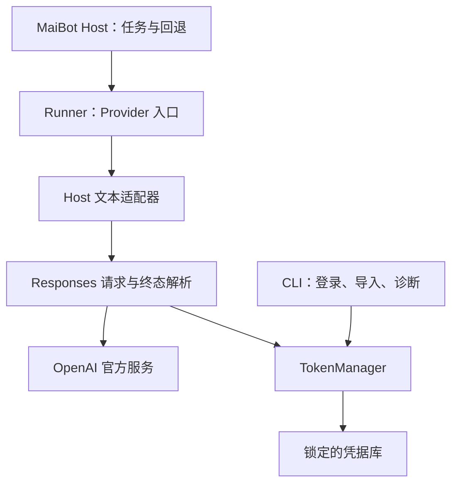

# 模块设计与数据流

## 职责划分

Host 适配器只关心 MaiBot 协议快照；Responses 适配器只关心官方请求；`TokenManager` 不导入 MaiBot，使离线开发与测试完全独立。

## Provider 单次调用流程

1. 校验 `operation=response`、已验证的 `item_schema_version`、模型标识、纯文本内容与参数；不支持项在访问网络前直接失败。
2. 检查本地暂停/冷却状态与官方目标 URL；经 `TokenManager` 获取有效 access token 与当前 `session_generation`。
3. 将上下文按序映射为 Responses `input` 数组：`SystemMessageItem` → `developer`，`UserMessageItem` → `user`，`AssistantMessageItem`（含文本与 `refusal`）→ `assistant`。各角色 `content` item 类型须符合官方 Responses API 规范（例如 `assistant` 历史使用 `output_text`/`refusal` 而非 `input_text`）。P0 不发顶层 `instructions`，避免与 `developer` 重复注入。
4. 仅发送白名单字段：`model`、`input`、`store=false`、`stream=true`。
5. 发起有界 HTTP/SSE 请求并消费至明确终态，仅记录脱敏元信息（状态、耗时、`request_id`）。
6. 核对 `session_generation` 未因登出/导入改变后，返回 Host 可反序列化字典；卸载时停止接新请求并安全收尾在途刷新。

## 参数处理决定

| Host 字段 | P0 行为 |
| --- | --- |
| `model_info.model_identifier` | 使用用户从账号目录选定的真实 slug |
| `context_items` | 仅接受已验证 schema 的纯文本与助手 `refusal` 历史 |
| `message_list` | 仅在 G0 实测目标为旧协议时增加窄兼容分支 |
| `temperature`、`max_tokens` | **忽略不传**（不因 Host 默认下发而拒绝请求），记录一次性脱敏提示 |
| `tool_options`、tool history | 非空即拒绝，不静默删除 |
| `response_format` | 空或纯文本可接受；JSON Schema 等结构化约束拒绝 |
| `extra_params` | 仅接受空对象；非空未知字段直接报错拒绝 |
| `api_provider` | 仅读已验证超时等元数据；不读取 `api_key`、不透传原字典 |

因服务端不支持 `max_output_tokens`，本地须设缓冲字节上限（默认 1 MiB）；触发时取消流并报错，不返回截断半成品。

## SSE 终态与计量

- 优先使用官方 Python SDK 解析 SSE，上层叠加本项目终态状态机。
- 仅 `response.completed` 且内部状态一致、含有效正文或合法 `refusal` 才成功；`response.failed`、`response.incomplete`、顶层 `error`、EOF、超时、仅 `[DONE]` 或空输出均失败，丢弃已累积半段文本。
- 以完成事件最终 `output` 为准（或与聚合 delta 核对），严禁把 delta 与全文重复拼接；内部 `reasoning` 不拼进用户回复；未请求工具却收到工具输出则报协议不匹配。
- 合法拒答在 schema 1 返回 `AssistantMessageItem` 的 `{"type": "refusal", "refusal": "..."}`，不触发技术重试，且下一轮作为助手历史可正常回传。
- `usage`：`input_tokens` → `prompt_tokens`，`output_tokens` → `completion_tokens`，`total_tokens` 仅用上游值；缺失则省略 `usage`，不伪造 0。

## 超时与并发

- 分开配置锁等待、OAuth/JWKS HTTP、连接、流空闲与请求总时长。因需在插件内完整消费 SSE，默认 `total_timeout_seconds = 180`（Host `timeout = 200`），思考模型可按需调高。
- P0 默认每会话最大在途推理 `max_concurrent_requests = 1`，队列有界并计入总时长。
- 生产入口固定官方域名，测试注入本地 mock server 的能力不得暴露为可配置的 `base_url`。
